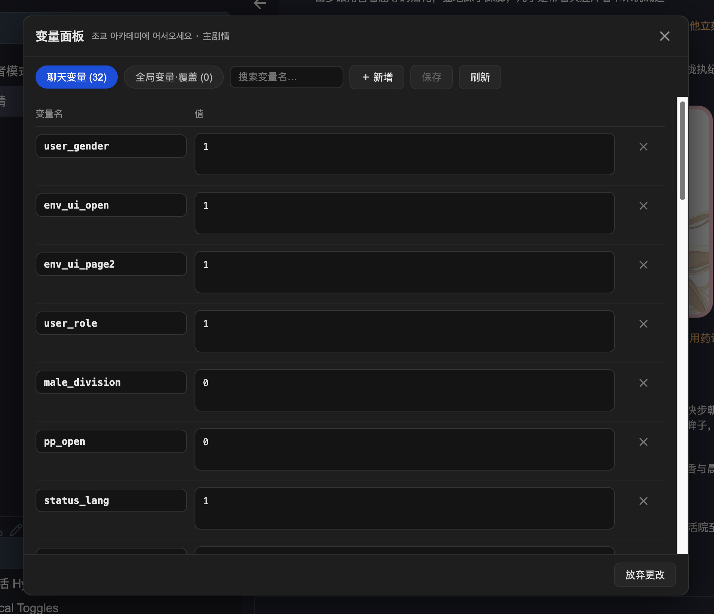

# Variable Panel

[English](README.md) | [简体中文](README.zh-CN.md)

A RisuAI plugin — a SillyTavern-helper-style chat variable editor, plus a card-agnostic **variable protocol accelerator**.

Single file, zero dependencies: `variable-panel.js` (plugin API v3.0).

## Features

### 1. Variable table (editor)

- **Chat variables**: read/write the current chat's variables — same source of truth as `{{getvar}}` / `{{setvar}}` / Lua `chatvar` / the `/setvar` command; isolated per chat
- **JSON friendly**: objects/arrays are pretty-printed with a JSON badge and compacted back on save; invalid JSON is flagged in red
- **Unwritten defaults**: variables defined in the character/preset but not yet materialized in this chat are listed separately — write them in with one click
- **Global variable overrides**: manage this chat's override layer (`{{getglobalvar}}` reads it first); you can query the current global value before adding one
- Search/filter, add/rename/delete, unsaved-change counter, **chat-switch guard** (a stale panel can never write to the wrong chat)
- Two entry points: the 🧮 floating button (top-right) and "变量面板" in the input box `⋮` menu

### 2. Macro accelerator (v1.1.0)

When an AI message lands, **immediately execute any `{{setvar::key::value}}` macros inside it** and write the values.

- **Card-agnostic**: it only recognizes RisuAI platform macro syntax and never parses a card's private output format
- **No native wait**: without acceleration those macros execute natively only right before the *next* generation (values lag one turn); the accelerator removes that lag — open the panel and values are already up to date
- **Only absolute `setvar` is accelerated**: `{{addvar}}` is left to the native engine — plugin + native each executing an addvar would double-count, while setvar is idempotent and therefore safe
- **Permission**: the first time you open the panel, a one-time "replacer" permission dialog appears — click allow. Denying it costs nothing but the one-turn lag
- It only triggers when the literal `{{setvar::` appears in a message, so cards without a variable protocol never pay anything

## Pairing with a "variable protocol" card (recommended)

The plugin deliberately does **not** parse card output formats — every card's status block is different, and hardcoding them is whack-a-mole. The generic recipe keeps variable semantics *inside the card*, on top of native macros:

1. An **editoutput regex** in the card mechanically converts its own status block (e.g. `<statusData>…</statusData>`) into appended `{{setvar}}` macros;
2. An **editdisplay regex** hides the macro text (display-only, never touches stored data);
3. A **truth-injection lorebook entry** (`{{getvar}}` expands current values + instructs the AI to echo them) prevents numeric drift.

The AI just keeps emitting its usual status block; variables update automatically and new characters get variables automatically. Macros in a message are executed natively before the next generation and then **automatically stripped from the message** (one-shot, never double-counted). This plugin makes all of it instant and gives you the editing UI.

Reference implementation: `local/build_varprotocol.py` in the RisuAI repo (the variable-protocol builder for the 조교 아카데미 card, including varId name normalization).

## Install

RisuAI → Settings → Plugins → Import plugin, and pick `variable-panel.js`.
Requires a reasonably recent RisuAI (plugin API v3.0, 2025+).

## Usage

1. Open any character's chat and click 🧮 top-right (a permission dialog appears the first time — allow it)
2. Edit values in the table, `＋` to add a variable, `✕` to delete
3. Click **Save**. `{{getvar}}` content re-renders with the next message; if a card's status panel looks stale, just send any message
4. The accelerator needs no action at all — it works as soon as installed

## Implementation notes

| Layer | Storage | Read/write path |
|---|---|---|
| Chat variables | `characters[i].chats[chatPage].scriptstate` (`$`-prefixed keys) | `risuai.getCharacter()` snapshot → mutate → `risuai.setCharacter()` |
| Global overrides | `GLGlobalVariables` on the same chat object | same |
| Macro accelerator | `{{setvar}}` macros in message text | `risuai.addRisuChatListener('output')` → regex extract → the same write path (with chat-switch guard) |

Timing: AI output → (card protocol) editoutput appends macros → **accelerator writes immediately** → before the next generation the native runVar pass executes them again (idempotent) and strips the macros from the message.

## Warning: multiple tabs on the same instance

RisuAI manages saves with an "active tab" protocol: once a **second tab** opens the same instance, whichever tab saves later deactivates the earlier one — a "this tab is deactivated" dialog pops up, and dismissing it reloads the page, losing in-memory changes that hadn't been flushed. `/setvar` and panel saves are both affected. This is RisuAI's own mechanism (same reason you must close both desktop and phone pages on a self-hosted instance before patching the save file).

- After saving from the panel, don't close/refresh immediately while another same-origin tab is active;
- If the "tab deactivated" dialog appears, handle it before touching variables. Single-tab usage is unaffected.

## Changelog

- **1.1.0** macro accelerator: immediate execution of `{{setvar}}` (generic, card-format-agnostic)
- 1.0.1 fix: panel stuck on "saving…" after a successful save
- 1.0.0 initial release: the variable table editor
